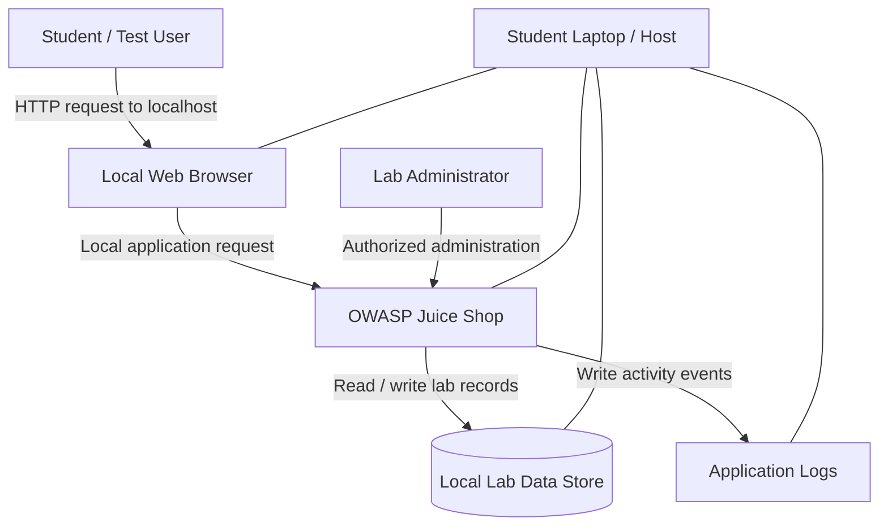

# 3. Data-Flow Diagram

## 3.1 Diagram

The editable Mermaid source is also available at `diagrams/data-flow.mmd`.

## 3.2 Data-flow description

1. The student opens the local training application through a browser.
2. The browser sends requests to the application on the local machine.
3. The application processes requests and interacts with its lab data store.
4. Application events may be written to local logs.
5. The lab administrator performs permitted configuration and maintenance activities.

## 3.3 Security considerations

- Restrict the service to the local host rather than exposing it to a network.
- Use synthetic test data and lab-only credentials.
- Protect configuration files and avoid committing secrets.
- Keep logs local and redact credentials or session values before sharing evidence.
- Stop the application when the exercise is complete.
